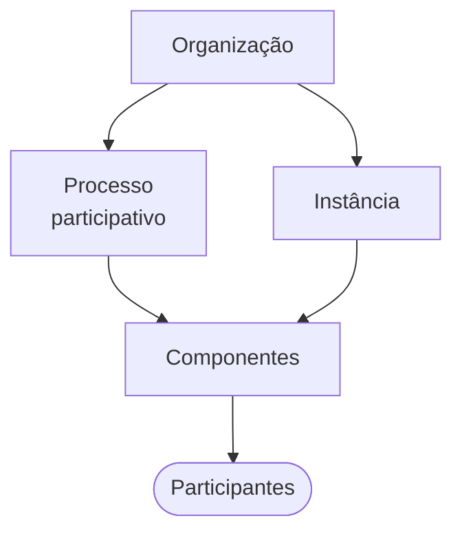
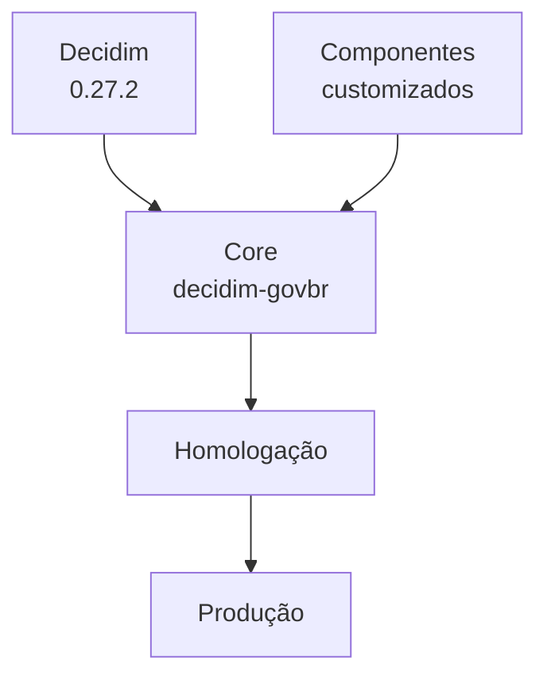
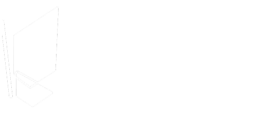
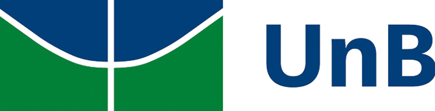

---
hide:
  - navigation
  - toc
hide_feedback: true
---

Documentação técnica · software livre

# Documentação do Brasil Participativo

Entenda como funciona a plataforma de participação digital do governo federal e siga o caminho certo para usar, operar ou desenvolver. Tudo é software livre, construído sobre o [Decidim](https://decidim.org/).

[Escolha sua trilha](#por-onde-comecar){ .md-button .md-button--primary }
[Entenda em 3 passos](#em-3-passos){ .md-button }
[:material-file-pdf-box: Baixar PDF](https://rochacarla.github.io/doc-bp/documentacao-brasil-participativo.pdf){ .md-button }

<nav class="bp-roteiro" aria-label="Roteiro desta página">
  Nesta página
  <a href="#em-3-passos">1Entenda o básico</a>
  <a href="#como-as-pecas-se-encaixam">2Veja como se encaixa</a>
  <a href="#por-onde-comecar">3Escolha seu caminho</a>
  <a href="#mapa-da-documentacao">4Explore as abas</a>
  <a href="#quem-faz">5Quem faz</a>
</nav>

1 · Entenda o básico

## O Brasil Participativo em 3 passos { #em-3-passos }

1.  :material-bank-outline:{ .bp-passos__icone } **Um órgão abre a participação**

    O **gestor de processo** cria um **processo participativo** (consulta pública, conferência, plano ou audiência) ou mantém uma **instância** permanente, como um conselho.

2.  :material-account-group-outline:{ .bp-passos__icone } **As pessoas participam**

    Com a conta **gov.br**, o **participante** propõe, vota, comenta e responde formulários, pelo site ou pelo WhatsApp e Telegram.

3.  :material-message-reply-text-outline:{ .bp-passos__icone } **O poder público responde**

    O órgão analisa as contribuições e dá a **devolutiva**: conta aos participantes o que foi feito com a participação.

[:octicons-arrow-right-24: Mais sobre a plataforma e as modalidades de participação](visao-geral/sobre.md)

2 · Veja como se encaixa

## Como as peças se encaixam { #como-as-pecas-se-encaixam }

Quase toda a documentação fala destas peças. Vale guardar os dois desenhos.

### :material-account-group-outline: Do lado de quem participa

**Espaço participativo**
:   Lugar onde a participação acontece: um processo participativo ou uma instância.

**Etapa**
:   Fase de um processo participativo, com período definido.

**Componente**
:   Funcionalidade que o gestor de processo adiciona a um espaço participativo, como propostas, reuniões ou formulários. Veja os [Módulos Decidim](modulos/propostas.md).

### :material-code-tags: Do lado do código

**Core**
:   O repositório principal, que instala o Decidim e muda o seu comportamento.

**Sobrescrita**
:   Arquivo do core que substitui o de mesmo caminho no Decidim. É o principal custo de atualização. Veja o [inventário](transferencia/sobrescritas.md).

**Componente customizado**
:   Extensão do Decidim feita pelo LabLivre/UnB. Veja [Componentes Customizados](componentes/homes.md).

[:octicons-arrow-right-24: Arquitetura completa](visao-geral/arquitetura.md) · [:octicons-arrow-right-24: Glossário com todos os termos](visao-geral/glossario.md)

3 · Escolha seu caminho

## Por onde começar { #por-onde-comecar }

Escolha o seu perfil. Cada [trilha de aprendizado](visao-geral/trilhas.md) é uma sequência de leitura: siga na ordem.

-   :material-account-group:{ .lg } **Quero participar**

    Para quem tem conta gov.br e quer propor, votar ou comentar.

    **Primeiro passo:** [Guias para o cidadão](manual/cidadao.md)
    { .bp-primeiro }

    [:octicons-arrow-right-24: Abrir a plataforma](https://brasilparticipativo.presidencia.gov.br/)

-   :material-account-tie:{ .lg } **Gestor de processo**

    Para quem cria e acompanha processos participativos num órgão.

    **Primeiro passo:** [Criar e publicar um processo](manual/informacoes-gerais.md)
    { .bp-primeiro }

    [:octicons-arrow-right-24: Trilha completa](visao-geral/trilhas.md)

-   :material-code-tags:{ .lg } **Desenvolvedor**

    Para quem vai escrever código no core ou em componentes.

    **Primeiro passo:** [Setup Local](dev/setup.md)
    { .bp-primeiro }

    [:octicons-arrow-right-24: Trilha completa](visao-geral/trilhas.md)

-   :material-server:{ .lg } **Equipe de operação**

    Para quem implanta, configura, monitora e integra a plataforma.

    **Primeiro passo:** [Deploy](operador/deploy.md)
    { .bp-primeiro }

    [:octicons-arrow-right-24: Trilha completa](visao-geral/trilhas.md)

-   :material-swap-horizontal:{ .lg } **Equipe receptora**

    Para quem vai assumir a manutenção e a operação da plataforma.

    **Primeiro passo:** [Transferência de Tecnologia](transferencia/index.md)
    { .bp-primeiro }

    [:octicons-arrow-right-24: Trilha completa](visao-geral/trilhas.md)

-   :material-chart-line:{ .lg } **Gestão e pesquisa**

    Para quem acompanha a evolução do projeto e os resultados da participação.

    **Primeiro passo:** [Estatísticas](estatisticas/index.md)
    { .bp-primeiro }

    [:octicons-arrow-right-24: Trilha completa](visao-geral/trilhas.md)

4 · Explore as abas

## Mapa da documentação { #mapa-da-documentacao }

O menu do topo tem dez abas. Veja o que há em cada uma.

-   :material-book-open-page-variant-outline:{ .lg } **Documentação**

    O coração técnico: o que é a plataforma, como desenvolver, operar e consultar o banco.

    [Visão Geral](visao-geral/sobre.md) [Desenvolvimento](dev/index.md) [Operação](operador/index.md) [Banco de Dados](banco-de-dados/index.md) [Módulos Decidim](modulos/propostas.md) [Componentes Customizados](componentes/homes.md)
    { .bp-chips }

-   :material-swap-horizontal:{ .lg } **[Transferência](transferencia/index.md)**

    Plano, inventário de ativos, segurança, APIs, release e atualização para a equipe receptora.

-   :material-clipboard-text-outline:{ .lg } **[Manual de Uso](manual/index.md)**

    Passo a passo do gestor de processo: criar, montar a Página Inicial, moderar e gerar relatórios.

-   :material-palette-outline:{ .lg } **[Design System](design-system/index.md)**

    Como o padrão visual gov.br foi aplicado sobre o Decidim.

-   :material-lightbulb-on-outline:{ .lg } **[Inovação](inovacao/index.md)**

    O que o Brasil Participativo mudou no Decidim.

-   :material-magnify-scan:{ .lg } **[Estudos](estudos/index.md)**

    Análises sobre a participação, como o Orçamento do Povo.

-   :material-chart-bar:{ .lg } **[Estatísticas](estatisticas/index.md)**

    Commits, merge requests, contribuições e qualidade do código.

-   :material-account-multiple-outline:{ .lg } **[Equipe](equipe/index.md)**

    Quem fez e faz o Brasil Participativo.

-   :material-information-outline:{ .lg } **[Sobre](sobre/index.md)**

    Quem produz esta documentação e como ela usa IA.

!!! tip "Para se orientar"
    Use a **busca** (tecla ++slash++) para achar qualquer termo. Dentro de uma página, a **trilha** acima do título mostra onde você está, e o **rodapé** leva à página anterior e à próxima. Para ler tudo em sequência, baixe o [e-book em PDF](https://rochacarla.github.io/doc-bp/documentacao-brasil-participativo.pdf).

5 · Quem faz

## Quem faz: o TED e o LabLivre { #quem-faz }

  
<strong>SNPS</strong>Secretaria Nacional de Participação Social: gestão da plataforma

  
TED

  
<strong>LabLivre/UnB</strong>desenvolvimento, manutenção e documentação

  

  
<strong>Brasil Participativo</strong>em produção, hospedado pela Dataprev

{ .bp-quemfaz__logo .bp-quemfaz__logo--lablivre } { .bp-quemfaz__logo .bp-quemfaz__logo--inverte }

### O LabLivre

O **Laboratório de Competência em Software Livre** da Universidade de Brasília desenvolve e mantém o Brasil Participativo e produz esta documentação, com participação de estudantes e professores. Todo o trabalho é software livre.

[:octicons-arrow-right-24: Conheça a equipe](equipe/index.md) · [:octicons-arrow-right-24: lablivre.unb.br](https://lablivre.unb.br)

### O TED

O **Termo de Execução Descentralizada** é o instrumento pelo qual um órgão federal transfere crédito orçamentário a outro órgão ou entidade federal, como uma universidade, para executar ações de interesse comum.

O TED entre a UnB e a **Secretaria Nacional de Participação Social (SNPS)**, da Secretaria-Geral da Presidência da República, viabiliza o desenvolvimento, a manutenção e a documentação da plataforma.

[:octicons-arrow-right-24: Sobre esta documentação](sobre/index.md)

## Brasil Participativo em números

<strong>2,0 mi</strong>participantes

<strong>13,3 mi</strong>acessos

<strong>596</strong>processos participativos

<strong>4.675</strong>commits no core desde abril de 2023

<strong>44</strong>pessoas contribuidoras

Participantes, acessos e processos: [página inicial do Brasil Participativo](https://brasilparticipativo.presidencia.gov.br/) em 14 de novembro de 2026. Commits e contribuidores: [Estatísticas](estatisticas/index.md).
{ .bp-fonte }

## Novidades

- **Login pelo WhatsApp e Telegram**: o retorno ao canal agora vem assinado no JWT, e a tela final tem o botão "Voltar para o WhatsApp". [Integração OP-BP](operador/integracao-op-bp.md)
- **Votos mutuamente exclusivos** entre componentes de propostas de um mesmo processo. [Propostas](modulos/propostas.md)
- **Instâncias criadas automaticamente** a partir dos órgãos públicos, de hora em hora. [Administração](operador/administracao.md#instancias-assembleias)

[:octicons-arrow-right-24: Todas as novidades](novidades.md)

## Links úteis

| | |
|---|---|
| Plataforma em produção | [brasilparticipativo.presidencia.gov.br](https://brasilparticipativo.presidencia.gov.br/) |
| Código do core | [gitlab.com/lappis-unb/decidimbr/decidim-govbr](https://gitlab.com/lappis-unb/decidimbr/decidim-govbr) |
| Componentes | [components-brasil-participativo](https://gitlab.com/lappis-unb/decidimbr/components-brasil-participativo) |
| Comunidade | [Grupo no Telegram](https://t.me/+nm4bkXxYukFlOWZh) |
| Decidim | [decidim.org](https://decidim.org/) · [documentação oficial](https://docs.decidim.org/) |
| Design System gov.br | [gov.br/ds](https://www.gov.br/ds/) |
